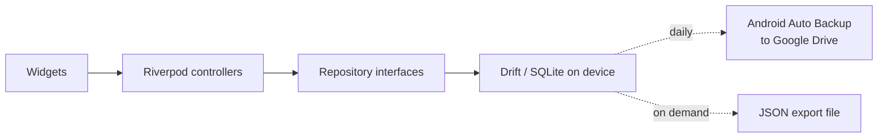

# Architecture

bajet is a single-user, offline-first Flutter app. All data lives in a SQLite
database on the phone. There is no backend, no account and no login.

## System overview



### Why there is no backend

A login protects data that sits on a server or is shared between people. bajet
has one user, one device and nothing shared, so the phone's lock screen already
does that job. Removing the server also removes hosting, auth and sync code.
See [decisions](decisions.md#001-local-first-no-login).

### Network

Release builds declare no `INTERNET` permission. Fonts are bundled. The only
planned network feature is the coach (v1.3), which will use the owner's own API
key held in secure storage.

## Layers

Data flows one way:

```
widget → controller (Riverpod) → repository interface → data source (drift)
```

| Layer          | Holds                                               | May depend on      |
|----------------|-----------------------------------------------------|--------------------|
| `presentation` | Screens, widgets, Riverpod controllers              | `domain`           |
| `domain`       | Models, repository interfaces, pure logic           | nothing            |
| `data`         | Repository implementations, drift tables and DAOs   | `domain`, `core`   |

Repository interfaces are the seam for any future cloud sync: a second
implementation can replace the drift one without touching screens.

## Folder structure

```
lib/
  main.dart
  app/                  router, shell, bootstrap
  core/
    database/           drift tables, the database class and its defaults
    dates/              dd/mm/yyyy formatting, the only place dates become text
    money/              sen ↔ RM formatting, the only place money becomes text
    navigation/         route paths, so features can link without the router
    platform/           screens bajet opens outside itself (camera, pickers, share sheet)
    sharing/            the share sheet and the "Save to" screen, for backups and reports
    theme/              colour, spacing, radii and motion tokens
    validation/         input formatters and validators
    widgets/            widgets shared by two or more features
  features/
    <feature>/
      data/
      domain/
      presentation/
```

A folder under `core/` appears only once two features need it.

## Features

| Feature  | Owns                                                                  |
|----------|-----------------------------------------------------------------------|
| `accounts` | The places money is kept (cash, banks, e-wallets), each one's balance and card, and money moved between them |
| `ledger` | Entries, categories and favourites, the log sheet, history, balance and flexible-spend maths |
| `plan`   | Settings, weekly rhythm, recurring items, planned events, goals, the projection and the Runway screen |
| `today`  | The Today screen: balance, today's rule, bills due, the week dial, goal, recent entries |
| `settings` | The Settings hub behind Today's gear: balance, accounts, allowance and buffer, goals, bills and income, planned events, the weekly rhythm and favourites |
| `backup` | JSON export saved to a folder or through the share sheet, and restore from a picked file |
| `checkin` | The Sunday check-in: compare each account with what it really holds (the bank app as a whole while there is one account), log any gap to that account, look back at the week |
| `report` | Reports of a week, a month or all time, shared as text, PDF (the `pdf` package) or CSV |
| `launch` | Launcher shortcuts: one `bajet://log` link format, a pending launch held until the shell can open the logger, and keeping the shortcuts in step with the favourites |
| `insights` | The Insights tab: money in and out, fixed against flexible, categories, the last fourteen days and habits, for a week, a month or all time |
| `coach`  | The Coach tab: questions answered by Anthropic with the owner's own key from Settings → Coach, up to 10 a day. The model reads the owner's figures through read-only lookups run on the phone (`coach_lookups.dart`, looped in `coach_answer.dart`); the week's summary can still be copied |
| `opening` | The opening played on a cold start: its timeline as plain data, the titanium cards and the lock screen's fan; the overlay that plays it lives in `app/` because it draws Today's and the lock screen's cards |
| `lock`   | The app lock: the lock screen over the whole app, asking for the phone's fingerprint or PIN on a cold start and after time away, and the owner's lock choices |
| `setup`  | First-run setup: where money is kept (at least one account, with what it holds now), weekly allowance, buffer, optional first goal, or a backup restore instead |

Shared providers live beside what they provide: `databaseProvider` and
`todayProvider` in `core/database/database_provider.dart`. Tests override both,
the first with an in-memory database and the second to pin the date.

## Navigation

`go_router` with a `StatefulShellRoute`: four top-level destinations behind
one bottom bar, each keeping its own stack and scroll position. Routes are
declared once in `lib/app/router.dart`; their paths live in
`lib/core/navigation/routes.dart` so a feature can link to another without
importing the router. History (`Routes.history`), the check-in (`Routes.checkin`)
and Settings (`Routes.settings`) sit under Today's branch but open on the root
navigator (`parentNavigatorKey`), so they and every page under them fill the
screen without the bottom bar, which belongs to the four tabs alone. Your
accounts (`Routes.accounts`) opens the same way but over Today, which stays
underneath while the page draws its own arrival from where Today's stack was
(`StackPlaces`, passed as the route's `extra`). The report
(`Routes.report`) sits above the tabs, so it opens the same way from Settings,
Insights and the check-in, and takes the range as `?period=week|month|all`
plus `&offset=-n` for a week or month n back from the current one.

Until setup has saved its settings, every route redirects to
`/setup`; once settings exist, `/setup` redirects to Today. The router listens
to `settingsProvider`, so finishing setup moves on without the setup screen
navigating itself. Restoring a backup from setup works the same way: the
restored settings row is what moves the router on.

## Storage and backup

- **Database:** drift over SQLite, opened with `drift_flutter`. Money is stored
  as integer sen.
- **Android Auto Backup:** on. Android copies app data to the owner's Google
  Drive about once a day, while the phone is idle, charging and on Wi-Fi.
  The coach's API key is left out (`res/xml/backup_rules.xml` and
  `data_extraction_rules.xml`): it is encrypted with a Keystore key that is
  never backed up, so a restored copy could not be read.
- **Secrets:** the coach's Anthropic key is the only secret, kept with
  `flutter_secure_storage` (Android Keystore, iOS Keychain). It never enters
  the database, a backup file or the code.
- **JSON export and import:** Settings → Backup exports every table as one
  JSON file, saved where the owner picks or sent through the share sheet, and
  restores one picked with the system file picker, after confirming. Saving
  (also offered for PDF and CSV reports) opens Android's own "Save to" screen
  through `MainActivity`'s files channel, so it needs no storage permission;
  on iPhone the share sheet's Save to Files does the same job. It is the backup the owner controls, and the
  way a set-up plan is loaded onto a new phone. See the
  [backup format](data-model.md#backup-format).

## Network

The only network traffic is the coach: HTTPS requests to
`api.anthropic.com/v1/messages`, made from the phone with the owner's own
key. A question is one request, plus one more for each round of lookups the
model asks for (at most four, decision 022); each carries the conversation
and the results of the lookups so far, never the whole database. Nothing
else leaves the phone, and without a key nothing does at all. `INTERNET` is
in the manifest for this alone.

The coach's lookups (`coachLookups`) are Anthropic tool definitions:
`bajet_overview`, `bajet_period`, `bajet_entries`, `bajet_accounts` and
`bajet_plan`. `runLookup` answers them from a `CoachData` snapshot that
`coachDataProvider` builds from the loaded providers, and `coachAnswer`
runs the loop: send, run any lookups the reply asks for, send their results
back as `tool_result` blocks with the assistant turn unchanged, and after
four rounds send `tool_choice: none` so the model must answer. Requests use
`claude-sonnet-5-5` at `effort: low` with server-side `fallbacks: "default"`;
a `refusal` stop reason becomes `CoachProblem.refused`.

## Platforms

Android now; iOS later, since iOS builds need macOS tooling. Dart code must
not use Android-only APIs, so iOS is an addition rather than a rewrite.

## Build and run

```bash
flutter pub get
dart run build_runner build   # only after changing a table
flutter run
flutter analyze
flutter test
```

Build tooling note: `sqlite3` 3.x compiles or downloads SQLite through a Dart
build hook at build time. The app itself never downloads anything.

## Release phases

| Phase | Scope                                                                 |
|-------|-----------------------------------------------------------------------|
| v1    | Log, Today, weekly ring, history, basic runway, coach-ready export    |
| v1.1  | Insights, text, PDF and CSV reports, Sunday check-in, receipts        |
| v1.2  | What-if sliders, launcher shortcuts                                   |
| v1.3  | Coach                                                                 |
| later | Demo mode (`--dart-define=BAJET_DEMO=true`, in-memory made-up data), CI |
