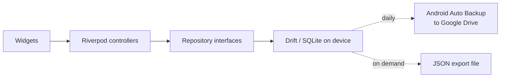

# Architecture

bajet is a single-user, offline-first Flutter app. All data lives in a SQLite
database on the phone. There is no backend, no account and no login.

## System overview



### Why there is no backend

A login protects data that sits on a server or is shared between people. bajet
has one user, one device and nothing shared, so the phone's lock screen already
does that job. Removing the server also removes hosting, auth and sync code.
See [decisions](decisions.md#001-local-first-no-login).

### Network

Release builds declare no `INTERNET` permission. Fonts are bundled. The only
planned network feature is the coach (v1.3), which will use the owner's own API
key held in secure storage.

## Layers

Data flows one way:

```
widget → controller (Riverpod) → repository interface → data source (drift)
```

| Layer          | Holds                                               | May depend on      |
|----------------|-----------------------------------------------------|--------------------|
| `presentation` | Screens, widgets, Riverpod controllers              | `domain`           |
| `domain`       | Models, repository interfaces, pure logic           | nothing            |
| `data`         | Repository implementations, drift tables and DAOs   | `domain`, `core`   |

Repository interfaces are the seam for any future cloud sync: a second
implementation can replace the drift one without touching screens.

## Folder structure

```
lib/
  main.dart
  app/                  router, shell, bootstrap
  core/
    database/           drift tables, the database class and its defaults
    dates/              dd/mm/yyyy formatting, the only place dates become text
    money/              sen ↔ RM formatting, the only place money becomes text
    navigation/         route paths, so features can link without the router
    sharing/            the share sheet, for backups and reports
    theme/              colour, spacing, radii and motion tokens
    validation/         input formatters and validators
    widgets/            widgets shared by two or more features
  features/
    <feature>/
      data/
      domain/
      presentation/
```

A folder under `core/` appears only once two features need it.

## Features

| Feature  | Owns                                                                  |
|----------|-----------------------------------------------------------------------|
| `accounts` | The places money is kept (cash, banks, e-wallets), each one's balance and card, and money moved between them |
| `ledger` | Entries, categories and favourites, the log sheet, history, balance and flexible-spend maths |
| `plan`   | Settings, weekly rhythm, recurring items, planned events, goals, the projection and the Runway screen |
| `today`  | The Today screen: balance, today's rule, bills due, the week strip, goal, recent entries |
| `settings` | The Settings hub behind Today's gear: allowance and buffer, goals, bills and income, planned events, the weekly rhythm and favourites |
| `backup` | JSON export through the share sheet and restore from a picked file |
| `checkin` | The Sunday check-in: compare with the bank, log any gap, look back at the week |
| `report` | Reports of a week, a month or all time, shared as text, PDF (the `pdf` package) or CSV |
| `launch` | Launcher shortcuts and the home-screen widget: one `bajet://log` link format, a pending launch held until the shell can open the logger, and syncing what the widget shows |
| `insights` | The Insights tab: money in and out, fixed against flexible, categories, the last fourteen days and habits, for a week, a month or all time |
| `coach`  | The Coach tab: questions answered by Anthropic with the owner's own key from Settings → Coach, up to 10 a day, given the week and month as context; the week's summary can still be copied |
| `setup`  | First-run setup: balance, weekly allowance, buffer, optional first goal, or a backup restore instead |

Shared providers live beside what they provide: `databaseProvider` and
`todayProvider` in `core/database/database_provider.dart`. Tests override both,
the first with an in-memory database and the second to pin the date.

## Navigation

`go_router` with a `StatefulShellRoute`: four top-level destinations behind
one bottom bar, each keeping its own stack and scroll position. Routes are
declared once in `lib/app/router.dart`; their paths live in
`lib/core/navigation/routes.dart` so a feature can link to another without
importing the router. History (`Routes.history`), the check-in (`Routes.checkin`)
and Settings (`Routes.settings`) sit under Today's branch but open on the root
navigator (`parentNavigatorKey`), so they and every page under them fill the
screen without the bottom bar, which belongs to the four tabs alone. The report
(`Routes.report`) sits above the tabs, so it opens the same way from Settings,
Insights and the check-in, and takes the period as `?period=week|month|all`.

Until setup has stored an opening balance, every route redirects to
`/setup`; once settings exist, `/setup` redirects to Today. The router listens
to `settingsProvider`, so finishing setup moves on without the setup screen
navigating itself. Restoring a backup from setup works the same way: the
restored settings row is what moves the router on.

## Storage and backup

- **Database:** drift over SQLite, opened with `drift_flutter`. Money is stored
  as integer sen.
- **Android Auto Backup:** on. Android copies app data to the owner's Google
  Drive about once a day, while the phone is idle, charging and on Wi-Fi.
  The coach's API key is left out (`res/xml/backup_rules.xml` and
  `data_extraction_rules.xml`): it is encrypted with a Keystore key that is
  never backed up, so a restored copy could not be read.
- **Secrets:** the coach's Anthropic key is the only secret, kept with
  `flutter_secure_storage` (Android Keystore, iOS Keychain). It never enters
  the database, a backup file or the code.
- **JSON export and import:** Settings → Backup exports every table as one
  JSON file through the share sheet and restores one picked with the system
  file picker, after confirming. It is the backup the owner controls, and the
  way a set-up plan is loaded onto a new phone. See the
  [backup format](data-model.md#backup-format).

## Network

The only network traffic is the coach: one HTTPS request to
`api.anthropic.com/v1/messages` per question, made from the phone with the
owner's own key, carrying the question and a short text summary of the week
and month. Nothing else leaves the phone, and without a key nothing does at
all. `INTERNET` is in the manifest for this alone.

## Platforms

Android now; iOS later, since iOS builds need macOS tooling. Dart code must
not use Android-only APIs, so iOS is an addition rather than a rewrite.

## Build and run

```bash
flutter pub get
dart run build_runner build   # only after changing a table
flutter run
flutter analyze
flutter test
```

Build tooling note: `sqlite3` 3.x compiles or downloads SQLite through a Dart
build hook at build time. The app itself never downloads anything.

## Release phases

| Phase | Scope                                                                 |
|-------|-----------------------------------------------------------------------|
| v1    | Log, Today, weekly ring, history, basic runway, coach-ready export    |
| v1.1  | Insights, text, PDF and CSV reports, Sunday check-in, receipts        |
| v1.2  | What-if sliders, home-screen widget, launcher shortcuts               |
| v1.3  | Coach                                                                 |
| later | Demo mode (`--dart-define=BAJET_DEMO=true`, in-memory made-up data), CI |
