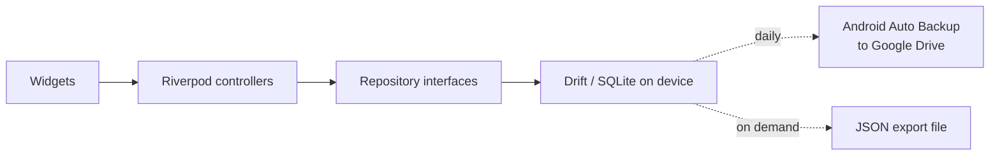

# Architecture

bajet is a single-user, offline-first Flutter app. All data lives in a SQLite
database on the phone. There is no backend, no account and no login.

## System overview



### Why there is no backend

A login protects data that sits on a server or is shared between people. bajet
has one user, one device and nothing shared, so the phone's lock screen already
does that job. Removing the server also removes hosting, auth and sync code.
See [decisions](decisions.md#001-local-first-no-login).

### Network

Release builds declare no `INTERNET` permission. Fonts are bundled. The only
planned network feature is the coach (v1.3), which will use the owner's own API
key held in secure storage.

## Layers

Data flows one way:

```
widget → controller (Riverpod) → repository interface → data source (drift)
```

| Layer          | Holds                                               | May depend on      |
|----------------|-----------------------------------------------------|--------------------|
| `presentation` | Screens, widgets, Riverpod controllers              | `domain`           |
| `domain`       | Models, repository interfaces, pure logic           | nothing            |
| `data`         | Repository implementations, drift tables and DAOs   | `domain`, `core`   |

Repository interfaces are the seam for any future cloud sync: a second
implementation can replace the drift one without touching screens.

## Folder structure

```
lib/
  main.dart
  app/                  router, shell, bootstrap
  core/
    database/           drift tables, the database class and its defaults
    money/              sen ↔ RM formatting, the only place money becomes text
    theme/              colour, spacing, radii and motion tokens
    widgets/            widgets shared by two or more features
  features/
    <feature>/
      data/
      domain/
      presentation/
```

A folder under `core/` appears only once two features need it.

## Features

| Feature  | Owns                                                                  |
|----------|-----------------------------------------------------------------------|
| `ledger` | Entries, categories and favourites; balance and flexible-spend maths  |
| `plan`   | Weekly rhythm, recurring items, planned events, goals, the projection |

Shared providers live beside what they provide: `databaseProvider` and
`todayProvider` in `core/database/database_provider.dart`. Tests override both,
the first with an in-memory database and the second to pin the date.

## Storage and backup

- **Database:** drift over SQLite, opened with `drift_flutter`. Money is stored
  as integer sen.
- **Android Auto Backup:** on. Android copies app data to the owner's Google
  Drive about once a day, while the phone is idle, charging and on Wi-Fi.
- **JSON export and import:** a manual backup the owner controls, and the way
  real data is loaded onto a device (planned for v1).

## Platforms

Android now; iOS later, since iOS builds need macOS tooling. Dart code must
not use Android-only APIs, so iOS is an addition rather than a rewrite.

## Build and run

```bash
flutter pub get
dart run build_runner build   # only after changing a table
flutter run
flutter analyze
flutter test
```

Build tooling note: `sqlite3` 3.x compiles or downloads SQLite through a Dart
build hook at build time. The app itself never downloads anything.

## Release phases

| Phase | Scope                                                                 |
|-------|-----------------------------------------------------------------------|
| v1    | Log, Today, weekly ring, history, basic runway, coach-ready export    |
| v1.1  | Insights, PDF and CSV export                                          |
| v1.2  | What-if sliders, home-screen widget, launcher shortcuts               |
| v1.3  | Coach                                                                 |
| later | Demo mode, CI                                                         |
