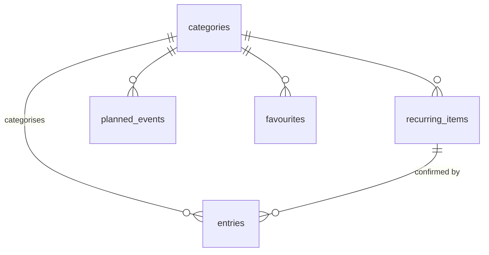

# Data model

The database is SQLite through drift, defined in `lib/core/database/tables.dart`.
Amounts are integer sen and always positive; the `kind` column says whether
money came in or went out. Calendar days are stored as ISO `yyyy-mm-dd` text.

## Tables

### `app_settings`
One row, created during first-run setup.

| Column            | Type | Notes                                     |
|-------------------|------|-------------------------------------------|
| `id`              | int  | Always 1                                  |
| `opening_balance` | int  | Balance on the opening date               |
| `opening_date`    | day  | Entries before this date are ignored      |
| `weekly_cap`      | int  | Flexible spending allowed per week        |
| `buffer`          | int  | Minimum left after buying a goal          |

### `categories`
| Column           | Type   | Notes                                           |
|------------------|--------|-------------------------------------------------|
| `key`            | text   | Primary key, e.g. `food`                        |
| `label`          | text   | Shown in the UI                                 |
| `kind`           | enum   | `income` or `expense`                           |
| `tint`           | text   | A `Tint` name from the design system            |
| `is_fixed`       | bool   | Fixed spending is excluded from the weekly cap  |
| `monthly_budget` | int?   | Optional                                        |
| `archived`       | bool   | Hidden from pickers, kept for history           |
| `sort_order`     | int    | Display order                                   |

### `entries`
Every logged spend or income. The balance is `opening_balance` plus the sum of
entries on or after `opening_date`.

| Column              | Type  | Notes                                       |
|---------------------|-------|---------------------------------------------|
| `id`                | int   | Primary key                                 |
| `occurred_on`       | day   |                                             |
| `kind`              | enum  | `income` or `expense`                       |
| `amount`            | int   | Greater than zero                           |
| `category_key`      | text  | References `categories.key`                 |
| `label`             | text? | Short name, e.g. "Coffee", for item stats   |
| `note`              | text? | Free text, never used in statistics         |
| `recurring_item_id` | int?  | Set when the entry confirms a recurring item|
| `created_at`        | time  |                                             |

### `weekly_rules`
The spending rhythm, one row per weekday (1 is Monday).

| Column           | Type | Notes                                   |
|------------------|------|-----------------------------------------|
| `weekday`        | int  | Primary key, 1–7                        |
| `label`          | text | e.g. "Weekday"                          |
| `day_type`       | enum | `zero`, `spend` or `flex`               |
| `planned_spend`  | int  | Used by the projection                  |
| `is_fasting_day` | bool | Marks the day with its own glyph        |

### `recurring_items`
Monthly bills and income.

| Column         | Type | Notes                                          |
|----------------|------|------------------------------------------------|
| `id`           | int  | Primary key                                    |
| `name`         | text |                                                |
| `kind`         | enum |                                                |
| `amount`       | int  | Greater than zero                              |
| `category_key` | text |                                                |
| `next_due`     | day  | Next unpaid occurrence; see decision 008       |
| `active`       | bool |                                                |
| `is_estimate`  | bool | The amount varies month to month               |

### `planned_events`
One-off future income or expenses.

| Column                | Type | Notes                                    |
|-----------------------|------|------------------------------------------|
| `id`                  | int  | Primary key                              |
| `name`, `kind`, `amount`, `category_key` | | As above                  |
| `due_on`              | day  |                                          |
| `done`                | bool |                                          |
| `count_in_projection` | bool | False for money that may not arrive      |

### `goals`
| Column        | Type   | Notes                                           |
|---------------|--------|-------------------------------------------------|
| `id`          | int    | Primary key                                     |
| `name`        | text   |                                                 |
| `price`       | int    | Greater than zero                               |
| `target_date` | day    |                                                 |
| `priority`    | int    | Lower is funded first                           |
| `listing_url` | text?  |                                                 |
| `status`      | enum   | `active`, `paused`, `achieved`, `archived`      |
| `achieved_on` | day?   |                                                 |

### `favourites`
Shortcuts that fill in the logger. They never log on their own.

| Column         | Type | Notes                |
|----------------|------|----------------------|
| `id`           | int  | Primary key          |
| `label`        | text |                      |
| `category_key` | text |                      |
| `amount`       | int  | Pre-filled, editable |
| `sort_order`   | int  |                      |

## Defaults on a new install

Eight expense categories (Food, Transport, Pets, Family, Gifts, Bills, Personal,
Other) and four income categories (Salary, KWSP, Refund, Other); only Bills,
Salary and KWSP start as fixed. The rhythm starts as "Weekday" and "Weekend"
with no planned spend. There are no favourites, goals or recurring items until
the owner adds them or imports a backup.

## Migrations

`schemaVersion` is 1. Any change to a table bumps it and adds a step to
`AppDatabase.migration`, tested before release.
