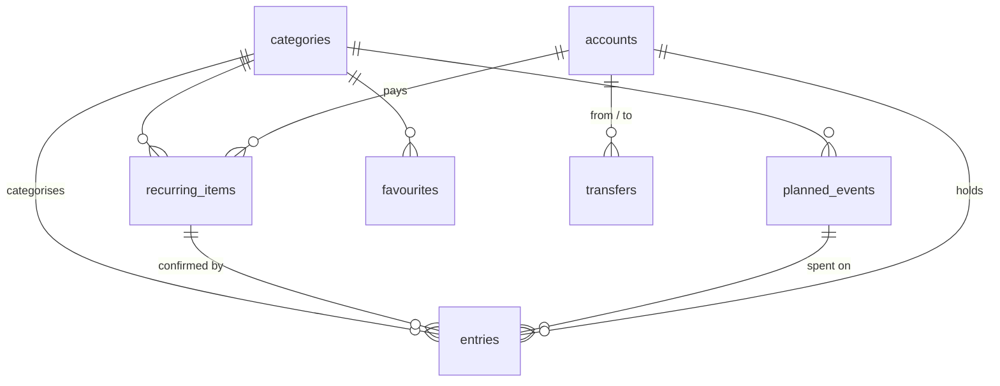

# Data model

The database is SQLite through drift, defined in `lib/core/database/tables.dart`.
Amounts are integer sen and always positive; the `kind` column says whether
money came in or went out. Calendar days are stored as ISO `yyyy-mm-dd` text.



## Tables

### `app_settings`
One row, created during first-run setup.

| Column            | Type | Notes                                     |
|-------------------|------|-------------------------------------------|
| `id`                | int  | Always 1                                  |
| `opening_date`      | day  | Balances ignore entries before this date; the week and Insights still count them (decision 020) |
| `weekly_cap`        | int  | Flexible spending allowed per week        |
| `buffer`            | int  | Minimum left after buying a goal          |
| `total_card_color`  | int? | The total card's colour as ARGB; null follows the app's theme |
| `total_card_finish` | enum | `matte` (default), `gloss`, `mirror`, `pearl`, `frosted` or `guilloche` |

### `accounts`
A place money is kept. Its balance is `opening_balance` on the opening date,
plus its entries and the transfers into it, less those out of it, since.

| Column            | Type  | Notes                                          |
|-------------------|-------|------------------------------------------------|
| `id`              | int   | Primary key                                    |
| `kind`            | enum  | `cash`, `bank` or `ewallet`                    |
| `name`            | text  | The provider as plain text, e.g. a bank's name; "Cash" for cash |
| `nickname`        | text? | e.g. "Savings", shown where a card has the holder's name |
| `opening_balance` | int   | Balance on the opening date                    |
| `color`           | int   | The card's colour as ARGB                      |
| `ink_color`       | int?  | The card's text colour when picked, e.g. gold on black; otherwise it follows the card's lightness |
| `finish`          | enum  | `matte` (default), `gloss`, `mirror`, `pearl`, `frosted` or `guilloche`; `leather` or `suede` for cash |
| `sort_order`      | int   | Display order, set by dragging cards on Your accounts (`reorderAccounts`); the first account at the time takes anything logged without one |

Deleting an account (`deleteAccount`) either moves what points at it into
another account or deletes that too. Moving re-files its entries, bills and
transfers under the other account and adds its `opening_balance` to that
account's, so the total never changes; transfers between the two are deleted,
since they would move money from an account to itself. The last account can
never be deleted. One transaction does it all, and `restoreAccount` writes
every changed row back for undo.

### `transfers`
Money moved from one account to another. Neither spending nor income, so it is
kept apart from `entries`: the total balance, the weekly allowance, Insights
and Runway never see it. Moving money (from an account view, or Your accounts)
writes one row dated today and offers to undo it, which deletes the row.
History lists every row, newest first (`watchTransfers`), and deleting one
there offers an undo that writes it again.

| Column            | Type  | Notes                                |
|-------------------|-------|--------------------------------------|
| `id`              | int   | Primary key                          |
| `occurred_on`     | day   |                                      |
| `from_account_id` | int   | References `accounts.id`             |
| `to_account_id`   | int   | References `accounts.id`; never the same as `from_account_id` |
| `amount`          | int   | Greater than zero                    |
| `note`            | text? |                                      |
| `created_at`      | time  |                                      |

### `categories`
| Column           | Type   | Notes                                           |
|------------------|--------|-------------------------------------------------|
| `key`            | text   | Primary key, e.g. `food`                        |
| `label`          | text   | Shown in the UI                                 |
| `kind`           | enum   | `income` or `expense`                           |
| `tint`           | text   | A `Tint` name from the design system            |
| `is_fixed`       | bool   | Fixed spending is excluded from the weekly cap  |
| `monthly_budget` | int?   | Optional                                        |
| `archived`       | bool   | Hidden from pickers, kept for history           |
| `sort_order`     | int    | Display order                                   |

### `entries`
Every logged spend or income. The total balance is every account's
`opening_balance` plus the sum of entries on or after `opening_date`.

| Column              | Type  | Notes                                       |
|---------------------|-------|---------------------------------------------|
| `id`                | int   | Primary key                                 |
| `occurred_on`       | day   |                                             |
| `kind`              | enum  | `income` or `expense`                       |
| `amount`            | int   | Greater than zero                           |
| `category_key`      | text  | References `categories.key`                 |
| `account_id`        | int   | References `accounts.id`; the logger asks for it (Paid from / Paid into) once there are two accounts, starting on the latest entry's |
| `label`             | text? | Short name, e.g. "Coffee", for item stats   |
| `note`              | text? | Free text, never used in statistics         |
| `receipt`           | text? | File name of an attached image, see below   |
| `recurring_item_id` | int?  | Set when the entry confirms a recurring item|
| `planned_event_id`  | int?  | Set when the entry was spent on a planned event |
| `planned_event_on`  | day?  | Which occurrence of that event it was for   |
| `created_at`        | time  |                                             |

### `weekly_rules`
The spending rhythm, one row per weekday (1 is Monday).

| Column           | Type | Notes                                   |
|------------------|------|-----------------------------------------|
| `weekday`        | int  | Primary key, 1–7                        |
| `label`          | text | e.g. "Weekday"                          |
| `day_type`       | enum | `zero`, `spend` or `flex`               |
| `planned_spend`  | int  | Used by the projection; 0 on `zero` days|
| `is_fasting_day` | bool | Turning it on makes the day `zero`      |

A day saved as `zero` (fasting days included) plans RM0.00, and whatever it
had planned moves evenly onto the days that still spend (`withRule`), so the
week keeps its total. A `zero` day switched back to spending works the other
way: its amount box fills with its even share of the week (`startingShare`;
the weekly allowance when no other day plans anything), and whatever it saves
is taken from the other spending days, never leaving one below RM0.00, so the
week still keeps its total; it may not take more than they plan. Days that
were an even split are split evenly again, so the outcome never depends on
the order days are switched; amounts typed unevenly keep their shape. Rhythm offers to spread the weekly allowance over the
spending days again whenever their total and the allowance differ.

### `recurring_items`
Monthly bills and income.

| Column         | Type | Notes                                          |
|----------------|------|------------------------------------------------|
| `id`           | int  | Primary key                                    |
| `name`         | text |                                                |
| `kind`         | enum |                                                |
| `amount`       | int  | Greater than zero                              |
| `category_key` | text |                                                |
| `next_due`     | day  | Next unpaid occurrence; see decision 008       |
| `active`       | bool |                                                |
| `is_estimate`  | bool | The amount varies month to month               |
| `window_days`  | int  | 0–27 days after `next_due` it may still land; 0 for a fixed day (decision 015) |
| `account_id`   | int  | The account it is paid from or into, chosen in its form once there are two accounts; confirmed entries go there |

### `planned_events`
Future income or expenses, once or every year.

| Column                | Type | Notes                                    |
|-----------------------|------|------------------------------------------|
| `id`                  | int  | Primary key                              |
| `name`, `kind`, `amount`, `category_key` | | As above                  |
| `due_on`              | day  | The next time it happens                 |
| `done`                | bool | Set only for a one-off event             |
| `count_in_projection` | bool | "Plan for it": false for something that might not happen at all, such as an unconfirmed bonus |
| `repeats_yearly`      | bool | Same date each year; done moves `due_on` on a year |

An expense event's `amount` is a budget. Entries spent on it carry its id and
the `due_on` of the occurrence they were for; what they add up to is what is
spent, and only what is left of the budget is still projected. Moving the
date carries that spending along; a yearly event marked done starts its next
year with nothing spent.

### `goals`
| Column        | Type   | Notes                                           |
|---------------|--------|-------------------------------------------------|
| `id`          | int    | Primary key                                     |
| `name`        | text   |                                                 |
| `price`       | int    | Greater than zero                               |
| `target_date` | day    |                                                 |
| `priority`    | int    | Lower is funded first                           |
| `listing_url` | text?  |                                                 |
| `status`      | enum   | `active`, `paused`, `achieved`, `archived`      |
| `achieved_on` | day?   |                                                 |

### `favourites`
Shortcuts that fill in the logger. They never log on their own.

| Column         | Type | Notes                |
|----------------|------|----------------------|
| `id`           | int  | Primary key          |
| `label`        | text |                      |
| `category_key` | text |                      |
| `amount`       | int  | Pre-filled, editable |
| `sort_order`   | int  |                      |

### `coach_settings`
How the coach looks and talks, and whether it remembers. One row, written
the first time any of it changes; until then the defaults below hold.

| Column        | Type | Notes                                         |
|---------------|------|-----------------------------------------------|
| `id`          | int  | Always 1                                      |
| `face`        | text | Avatar key: `bajety`, `aina`, `hafiz`, `mei`; default `bajety` |
| `personality` | text | Personality key; default `friendly`           |
| `remember`    | bool | Keep the chat between launches; default true  |

### `coach_messages`
The remembered chat, oldest first. It never leaves the phone: the backup
file does not carry this table or `coach_settings`.

| Column     | Type | Notes                                                  |
|------------|------|--------------------------------------------------------|
| `id`       | int  | Primary key                                            |
| `sent_at`  | int  | Milliseconds since the epoch                           |
| `from_user`| bool | False for the coach's replies                          |
| `body`     | text | What was said                                          |
| `face`     | text | The avatar that replied; null for the user's messages  |
| `looked`   | text | What the coach looked up, one label a line             |
| `cards`    | text | Suggestion cards and their outcome, as JSON; empty if none |

### `checkins`
One finished Sunday check-in a day; finishing again the same day replaces
it. Each row keeps what the next week's report is judged against.

| Column                | Type | Notes                                                    |
|-----------------------|------|----------------------------------------------------------|
| `checked_on`          | text | Primary key, the day it was finished                     |
| `balance`             | int  | What bajet held across every account                     |
| `matched`             | bool | Every account was compared with what it really holds and agreed |
| `untracked`           | int  | Money logged as untracked at this check-in; default 0    |
| `starting_adjustment` | int  | The gap found at the very first check-in, kept apart from untracked; default 0 |
| `allowance_spent`     | int  | Flexible spending that week, Monday to the check-in      |
| `left_after_buying`   | int? | What the first goal leaves after buying; null without a goal |
| `next_target`         | int  | The balance the plan expected seven days on              |

## Defaults on a new install

Eight expense categories (Food, Transport, Pets, Family, Gifts, Bills, Personal,
Other), two built-in fixed categories the app logs into itself and no picker
offers (Goals, for goal purchases, and Untracked, for money found missing at a
check-in), and four income categories (Salary, KWSP, Refund, Other); only
Bills, Goals, Untracked, Salary and KWSP start as fixed. The built-in pair is
re-added whenever the database opens and after every restore
(`ensureBuiltInCategories`), so older installs and backups gain them. The rhythm starts as "Weekday" and "Weekend"
with no planned spend; finishing setup then spreads the weekly allowance over
the seven days (`spreadOverWeek`), so no day starts planned at RM0.00 while the
week allows more. There are no favourites, goals or recurring items until
the user adds them or imports a backup.

## Receipts

An entry's receipt is an image file in a `receipts` folder inside the app's own
documents directory, which other apps cannot read and Android Auto Backup
copies. `entries.receipt` holds only its file name. Images are scaled to at
most 1600 px and saved as compressed JPEG, a few hundred KB each. At every
launch, before anything is being logged, files that no entry names are deleted
(`receiptCleanupProvider`), which clears the images of deleted entries and of
logs closed without saving.

## Backup format

A backup is one JSON file written by `DriftBackupRepository.export`:

```json
{
  "app": "bajet",
  "format": 8,
  "settings": { "openingDate": "2026-07-01", "weeklyCap": 5000, "buffer": 50000, "totalCardColor": null, "totalCardFinish": "matte" },
  "accounts": [], "transfers": [],
  "categories": [], "weeklyRules": [], "recurringItems": [],
  "plannedEvents": [], "goals": [], "favourites": [], "entries": [], "checkins": []
}
```

Each list holds one object per row, with the same fields as the tables above
in camelCase, amounts in sen and days as `yyyy-mm-dd`. The mapping is written
by hand rather than taken from drift, so the file format only changes when
`format` does. Older files are brought up to date one step at a time by
`upgradeBackup` before they are read:

| Format | Change                                                  |
|--------|---------------------------------------------------------|
| 1      | First release                                           |
| 2      | Each entry carries `receipt`, the file name of its image |
| 3      | Each recurring item carries `windowDays`; older files get 0 |
| 4      | Each planned event carries `repeatsYearly`; older files get false |
| 5      | Each entry carries `plannedEventId` and `plannedEventOn`; older files get null |
| 6      | `accounts` and `transfers`; each entry and recurring item carries `accountId`; settings carry `totalCardColor` and `totalCardFinish` in place of `openingBalance`, which older files turn into one account, "Main account", that every entry and item belongs to |
| 7      | No `brushed` finish: older files' brushed cards and total card restore as `matte` |
| 8      | `checkins`, the finished check-ins; older files restore with none |

A backup holds a receipt's file name, not the image itself, so a backup moved
to another phone brings the entries but not their pictures. Restoring replaces everything in one transaction; a file that
is not a bajet backup, has another `format`, or is damaged is refused and the
data on the phone is left as it was.

## Migrations

`schemaVersion` is 9. Any change to a table bumps it and adds a step to
`AppDatabase.migration`, tested against a saved copy of the old schema
(`test/core/fixtures/schema_v<n>.sql`) before release.

| Version | Change                                  |
|---------|-----------------------------------------|
| 1       | First release                           |
| 2       | `entries.receipt`, for attached receipts |
| 3       | `recurring_items.window_days`, for pay and bills that move around |
| 4       | `planned_events.repeats_yearly`, for birthdays and other yearly events |
| 5       | `entries.planned_event_id` and `planned_event_on`, for spending against an event |
| 6       | `accounts` and `transfers`; `entries.account_id` and `recurring_items.account_id`; the total card's look on `app_settings`, whose `opening_balance` moves to a first account, "Main account", which every existing entry and bill joins |
| 7       | Brushed metal retired: `accounts.finish` and `app_settings.total_card_finish` turn `brushed` into `matte`, which becomes their default |
| 8       | `coach_settings` and `coach_messages`, both new and empty, for the coach's look, personality and remembered chat |
| 9       | `checkins`, new and empty, for the weekly check-in's targets |
